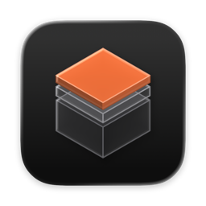
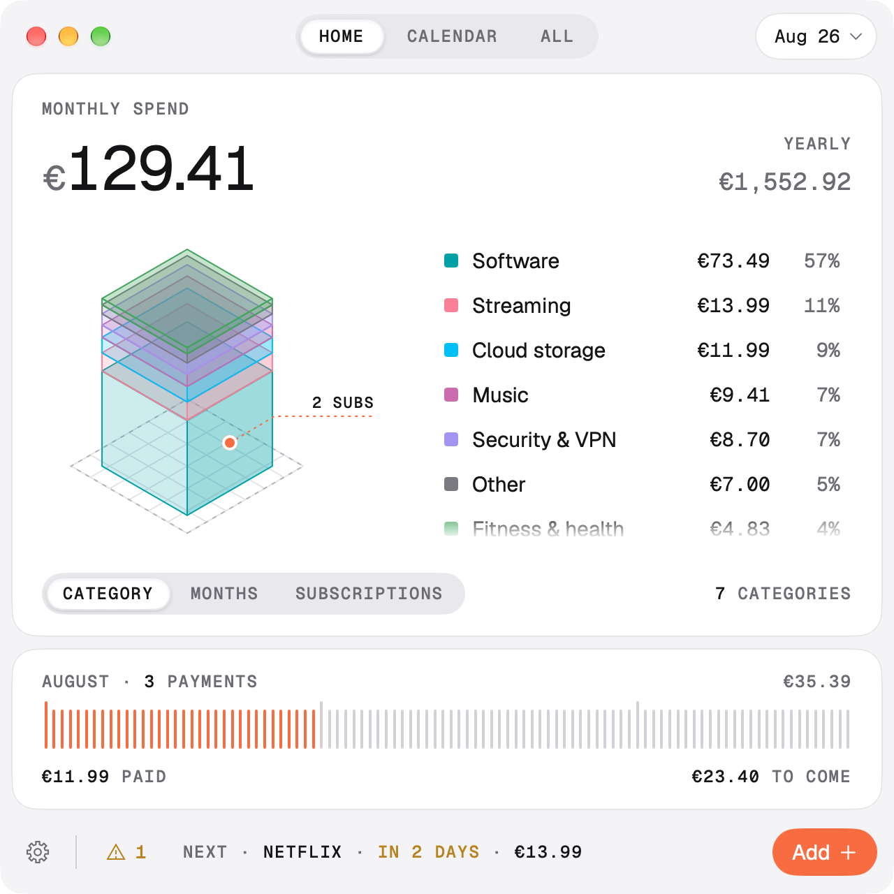

<p align="center">
  
</p>

<h1 align="center">Obolo</h1>

<p align="center">
  A subscription tracker for macOS.<br>
  See what you spend each month and which payment comes next.
</p>

<p align="center">
  <a href="#try-obolo">Try Obolo</a> · <a href="#your-data">Your data</a> · <a href="#development">Development</a>
</p>

<p align="center">
  <picture>
    <source media="(prefers-color-scheme: dark)" srcset="docs/images/home-dark.png">
    
  </picture>
</p>

## What you can track

- **Spending.** Compare costs by category or subscription. The Months view shows when annual renewals push spending up.
- **Renewals.** Pick a day to see what renews. Set reminders or add payments to Apple Calendar.
- **Price changes.** Record when a price changes and see past payments in the original currency.
- **Multiple currencies.** Keep original prices, compare totals in your chosen currency and see which subscriptions lack an exchange rate.

The menu bar can show your monthly total or your next payment. In Shortcuts, use **Show Next Renewal**, **Open Upcoming Subscriptions**, or **Add Subscription**.

## Try Obolo

Obolo is in development for **macOS 15 Sequoia or later**. You can build it from source using the instructions below.

To explore an example, drop the [sample CSV](design/fixtures/sample.csv) onto the Obolo window. Review the rows in the import preview before adding them. In **Home**, select **Subscriptions** and click a name to see its renewal date and price history.

## Your data

Obolo saves your library on your Mac. It requires no Obolo account and collects no telemetry.

| Feature | How it uses your data |
| --- | --- |
| iCloud sync | Turn it on to sync subscriptions, categories, manual exchange rates and custom logos between Macs through your private iCloud database. |
| Service logos | Obolo checks the subscription’s website for an icon. If its icon is missing or too small, the Google fallback sends Google the domain. You can turn the fallback off in Settings. |
| Exchange rates | Automatic updates send currency codes to Frankfurter. You can also enter rates by hand. |
| Export and backup | Export a CSV for a spreadsheet. A JSON backup includes subscriptions, categories, rates and settings. Logo images live separately. |

## Development

Building the app requires XcodeGen and Xcode with the macOS 26 SDK or later. On Sequoia, use Xcode 26.3 on macOS 15.6 or later. From the repository root, generate the project and open it in Xcode.

```sh
brew install xcodegen
xcodegen generate
open Obolo.xcodeproj
```

Choose the **Obolo** scheme and press **⌘R**. A signed run requires a development profile for the app ID `studio.anguria.obolo`, its App Group `group.studio.anguria.obolo` and its CloudKit container `iCloud.studio.anguria.obolo`. Edit build settings in [project.yml](project.yml), which XcodeGen uses to create the Xcode project.

### Run the tests

Both suites run without signing credentials. The app tests run without opening Obolo or reading your library.

```sh
swift test --package-path Core
xcodebuild -project Obolo.xcodeproj -scheme Obolo \
  -destination 'platform=macOS' CODE_SIGNING_ALLOWED=NO test
```

The [Swift package](Core/Sources/OboloCore) contains the billing calculations, renewal schedule, importers and shared subscription editor model. The [Mac app](App) contains the SwiftUI views and macOS integrations. The [CI workflow](.github/workflows/ci.yml) runs both suites on macOS 15 and 26 and builds the package for the iOS simulator.

<details>
<summary>Maintainer commands</summary>

To check the iOS build locally, run this from the repository root with the iOS simulator SDK installed.

```sh
(cd Core && xcodebuild -scheme OboloCore -destination 'generic/platform=iOS Simulator' CODE_SIGNING_ALLOWED=NO build)
```

If you change the CSV export format, regenerate the sample and review its diff.

```sh
(cd Core && OBOLO_REGENERATE_FIXTURES=1 swift test --filter sampleFixtureIsCurrent)
```

To package a signed development build, run these scripts in order.

```sh
scripts/build-release.sh
scripts/make-dmg.sh
```

</details>

## License

Obolo uses the [MIT License](LICENSE). The bundled Geist and Geist Mono fonts have their own [SIL Open Font License](App/Resources/Fonts/Geist-OFL.txt).
